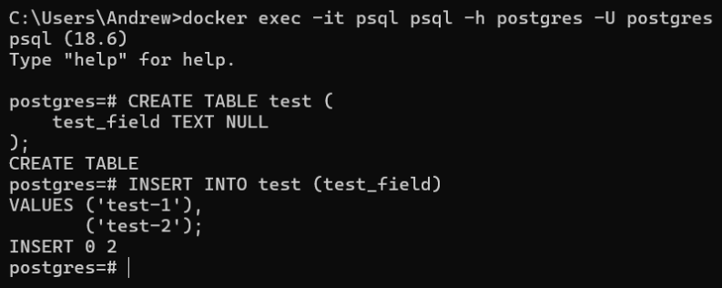
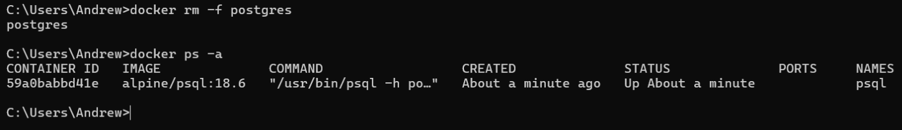
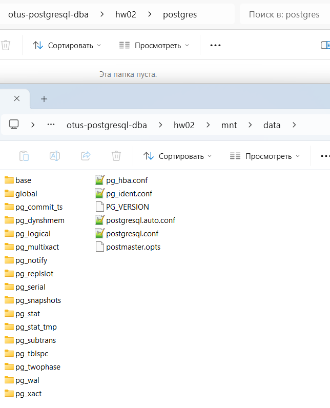
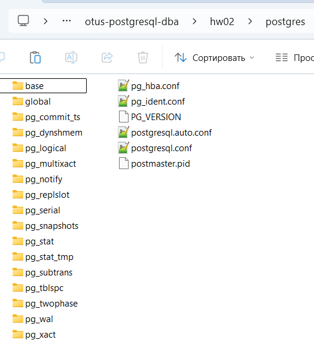
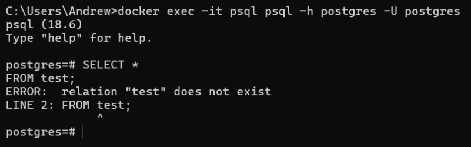
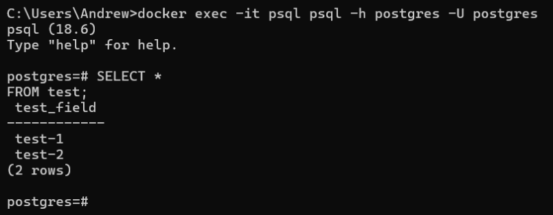

###### 1-3
Явное указание переменной PGDATA
```yaml
PGDATA: /var/lib/postgresql
```

###### 4
Подключение через psql
```sh
docker exec -it psql psql -h postgres -U postgres
```
Создание тестовой таблицы
```sql
CREATE TABLE test (    
    test_field TEXT NULL
);
```
Заполнение тестовой таблицы
```sql
INSERT INTO test (test_field)  
VALUES ('test-1'),  
       ('test-2');
```


###### 5
Остановка и удаление контейнера с PostgreSQL
```sh
docker rm -f postgres

docker ps -a
```


###### 6-9
Пункты имеют особенности при разворачивании PostgreSQL в Docker.\
Подключение второго volume '/mnt/data'.
```yaml
volumes:
  - ./postgres:/var/lib/postgresql
  - ./mnt/data:/mnt/data
```

###### 10
Перенос содержимого volume '/postgres' на volume '/mnt/data'.\


###### 11
Контейнер запустился с нуля, потому что volume '/postgres' был пустым и заполнился заново.\


Таблица test ожидаемо отсутствует.
```sql
SELECT *
FROM test;
```


###### 12
Существует параметры PGDATA и data_directory.\
PGDATA указывает путь до конфигурационных файлов, а data_directory - до каталога с данными.\
В Docker рекомендуют использовать только PGDATA.
```yaml
PGDATA: /mnt/data
```
При запуске PostgreSQL не в Docker, скорее всего, хватит указания пути до '/mnt/data' в параметре data_directory.

###### 14
Таблица и данные есть, потому что теперь PostgreSQL смотрит на '/mnt/data', куда перенесли данные в п.10.

