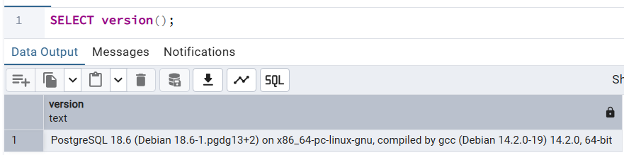
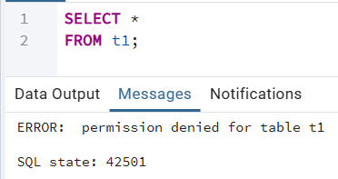
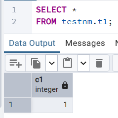
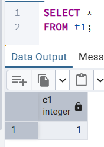
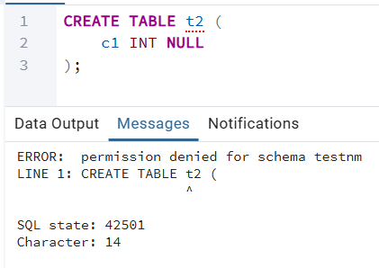
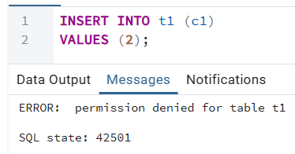

##### 1
###### Кластер PostgreSQL 18 (актуальная версия)


###### Создание БД testdb
```sql
CREATE DATABASE testdb;
```

##### 2
###### Создание схемы testnm и таблицы t1
```sql
CREATE SCHEMA testnm;

CREATE TABLE t1 (
    c1 INT NULL
);

INSERT INTO t1 (c1)
VALUES (1);
```
##### 3
###### Создание и настройка роли readonly
```sql
CREATE ROLE readonly;

GRANT CONNECT ON DATABASE testdb TO readonly;

GRANT USAGE ON SCHEMA testnm TO readonly;

GRANT SELECT ON ALL TABLES IN SCHEMA testnm TO readonly;
```

##### 4
###### Создание и настройка пользователя testread
```sql
CREATE USER testread WITH PASSWORD 'test123';

GRANT readonly TO testread;
```
###### SELECT из t1 не работает, потому что указана схема по умолчанию (public), доступа к которой нет
```sql
SELECT *
FROM t1;
```


##### 5
###### Удаляем таблицу t1 и пересоздаём её в схеме testnm
```sql
DROP TABLE t1;

CREATE TABLE testnm.t1 (
    c1 INT NULL
);

INSERT INTO testnm.t1 (c1)
VALUES (1);
```
###### Либо меняем схему таблицы t1, чтобы не пересоздавать таблицу. И повторно разрешаем SELECT всех таблиц схемы testnm для роли readonly
```sql
ALTER TABLE t1
    SET SCHEMA testnm;

GRANT SELECT ON ALL TABLES IN SCHEMA testnm TO readonly;
```
###### SELECT из testnm.t1 работает, потому что явно указана схема
```sql
SELECT *
FROM testnm.t1;
```

###### Настраиваем обращение к схеме testnm без явного указания схемы
```sql
SET search_path TO testnm;
```
###### SELECT из t1 работает
```sql
SELECT *
FROM t1;
```


##### 6
###### Пользователь testread не имеет права создавать таблицы
```sql
CREATE TABLE t2 (
    c1 INT NULL
);
```

###### Пользователь testread не имеет права вставлять строки
```sql
INSERT INTO t1 (c1)
VALUES (2);
```

