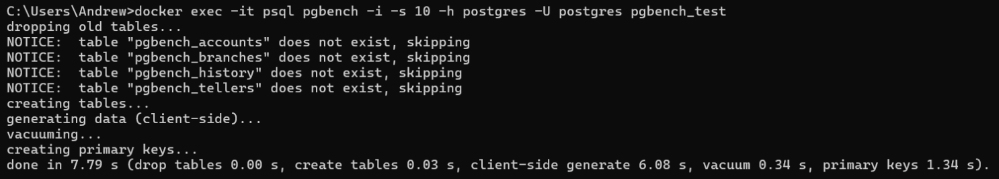
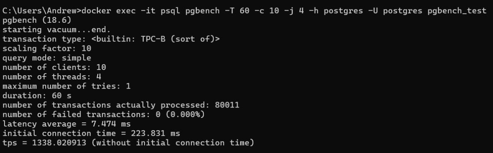
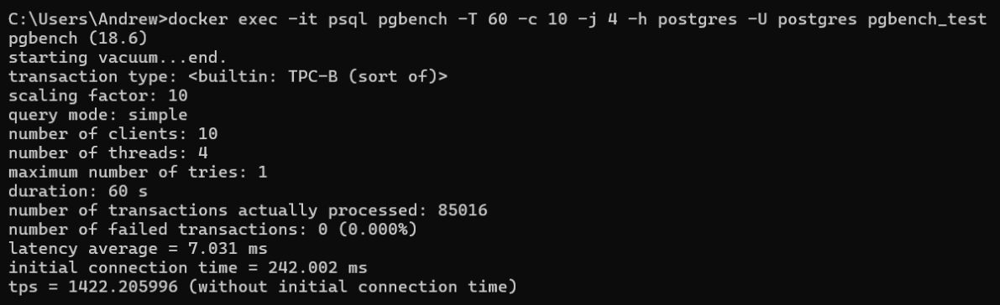
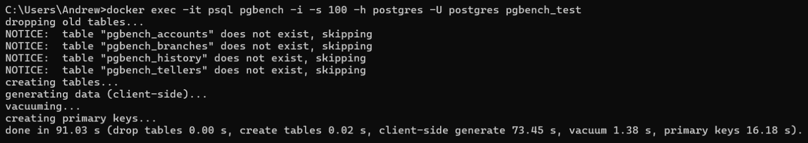
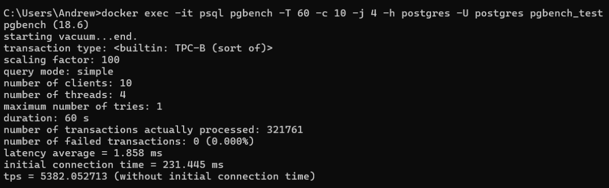

##### 1
Создание БД pgbench_test
```sql
CREATE DATABASE pgbench_test;
```

##### 2
Инициализация тестовой БД pgbench_test с scale = 10
```sh
docker exec -it psql pgbench -i -s 10 -h postgres -U postgres pgbench_test
```


##### 3
Baseline-прогон pgbench (60 секунд, 10 клиентов, 4 потока)
```sh
docker exec -it psql pgbench -T 60 -c 10 -j 4 -h postgres -U postgres pgbench_test
```

##### 4
tps = 1338.020913\


##### 5
###### Настройка параметров
WSL 2 использует все CPU и половину RAM хост-машины, поэтому задаём CPUs = 8 и RAM = 16.

Не нашёл универсальной инструкции для параметров max_wal_size и io_max_concurrency.\
max_wal_size в одних источниках советуют ставить 8-16 GB, в других - менять вместе с параметром checkpoint_timeout.\
io_max_concurrency советуют ставить то 64, то 128.\
Решил пока не трогать ни max_wal_size, ни checkpoint_timeout, ни io_max_concurrency.

Начальную настройку сделал с помощью [PGConfig](https://www.pgconfig.org/?max_connections=100&pg_version=18&environment_name=OLTP&total_ram=16&cpus=8&drive_type=SSD&arch=x86-64&os_type=linux).\
Опустил параметры, которые не изменились от значений по умолчанию.\
Дополнительно использовал ресурсы:
1. [Потребление ресурсов](https://postgrespro.ru/docs/postgresql/18/runtime-config-resource)
2. [Журнал предзаписи](https://postgrespro.ru/docs/shardman/18/runtime-config-wal)
3. [How to tune PostgreSQL for memory](https://www.enterprisedb.com/postgres-tutorials/how-tune-postgresql-memory)
4. [Best Practices for PostgreSQL Parameters Tuning](https://www.mydbops.com/blog/postgresql-parameter-tuning-best-practices)
```conf
# Generated by PGConfig 4.0.0 (de1c43a5aa2689104172a5923c5c8617357baad3)
# https://www.pgconfig.org/v1/tuning/get-config?format=conf&log_format=jsonlog&max_connections=100&pg_version=18&environment_name=OLTP&total_ram=16GB&cpus=8&drive_type=SSD&arch=x86-64&os_type=linux

# Memory Configuration
shared_buffers = 4GB
effective_cache_size = 8GB
work_mem = 41MB
maintenance_work_mem = 819MB

# Checkpoint Related Configuration
min_wal_size = 2GB

# Storage Configuration
random_page_cost = 1.1
effective_io_concurrency = 200
maintenance_io_concurrency = 200
```
###### Настройка дополнительных параметров
```conf
synchronous_commit = off
fsync = off
full_page_writes = off
```

##### 6
tps = 1422.205996\
\
Плюс применение параметров synchronous_commit, fsync и full_page_writes:\
tps = 4228.660864\


##### 7
На таком объёме данных больше всего заметно применение synchronous_commit, fsync и full_page_writes.\
Остальные параметры почти не заметно.\
Сравню при scale = 100
###### Инициализация тестовой БД pgbench_test
```sh
docker exec -it psql pgbench -i -s 100 -h postgres -U postgres pgbench_test
```

###### Baseline-прогон pgbench (60 секунд, 10 клиентов, 4 потока)
tps = 1687.447407\

###### Прогон pgbench (60 секунд, 10 клиентов, 4 потока) после применения параметров из п.5
tps = 1857.25248\

###### Прогон pgbench (60 секунд, 10 клиентов, 4 потока) после применения параметров из п.5 (+ synchronous_commit, fsync и full_page_writes)
tps = 5382.052713\

Как видно, при scale 100 применение параметров более заметны.\
И ещё больше выделяются параметры synchronous_commit, fsync и full_page_writes.

##### 8
Больше всего повлияли параметры:
1. synchronous_commit, fsync и full_page_writes (выставлены в самый небезопасный режим)\
Я бы рискнул менять их в продуктивной БД только при наличии плана восстановления после сбоев питания или ОС.
2. shared_buffers (выставлен для работы с большим объёмом ОЗУ)
3. random_page_cost / effective_io_concurrency / maintenance_io_concurrency (выставлены для работы с SSD)

Возможно, ещё work_mem, если в тестовых запросах есть DISTINCT, HASH JOIN или ORDER BY.\
Сложно оценить вклад параметра min_wal_size без исследования max_wal_size и checkpoint_timeout.

##### Таблица параметров
| Параметр                   | Было  | Стало | Зачем изменён                      |
| -------------------------- | ----- | ----- | ---------------------------------- |
| shared_buffers             | 128MB | 4GB   | 25% от ОЗУ                         |
| effective_cache_size       | 4GB   | 8GB   | 50% от ОЗУ                         |
| work_mem                   | 4MB   | 41MB  | ОЗУ * 0.25 / max_connections (100) |
| maintenance_work_mem       | 64MB  | 819MB | ОЗУ * 0.05                         |
| min_wal_size               | 80MB  | 2GB   | 25% от max_wal_size (1GB)          |
| random_page_cost           | 4.0   | 1.1   | Так советуют для SSD               |
| effective_io_concurrency   | 16    | 200   | Так советуют для SSD               |
| maintenance_io_concurrency | 16    | 200   | Так советуют для SSD               |
| synchronous_commit         | on    | off   | Для эксперимента                   |
| fsync                      | on    | off   | Для эксперимента                   |
| full_page_writes           | on    | off   | Для эксперимента                   |
