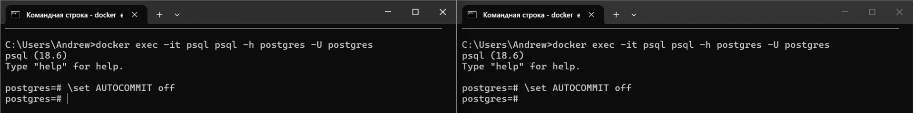
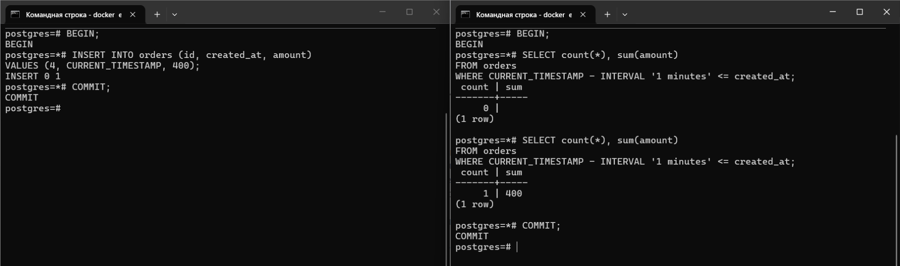
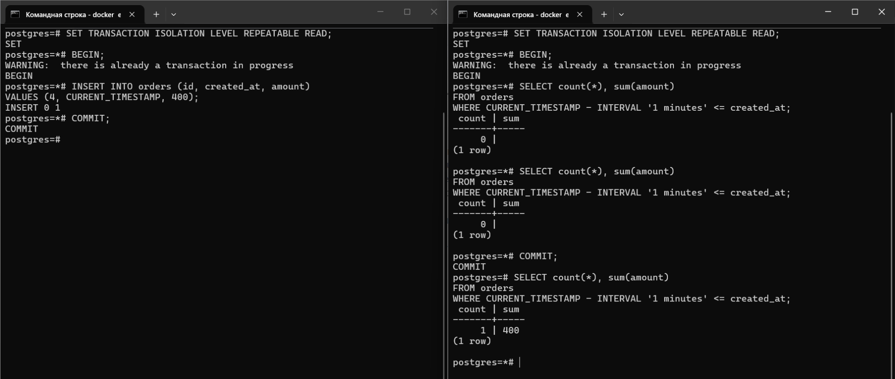

##### 1
Сессии psql без autocommit
```sh
docker exec -it psql psql -h postgres -U postgres

\set AUTOCOMMIT off
```


##### 2
```sql
CREATE TABLE orders (
    id         SERIAL      NOT NULL,
    created_at TIMESTAMPTZ     NULL,
    amount     NUMERIC         NULL
);

INSERT INTO orders (id, created_at, amount)
VALUES (1, CURRENT_TIMESTAMP - INTERVAL '3 minutes', 100),
       (2, CURRENT_TIMESTAMP - INTERVAL '2 minutes', 200),
       (3, CURRENT_TIMESTAMP - INTERVAL '1 minutes', 300);
```

##### 3
###### Сессия 1
```sql
BEGIN;

INSERT INTO orders (id, created_at, amount)
VALUES (4, CURRENT_TIMESTAMP, 400);

COMMIT;
```
###### Сессия 2
```sql
BEGIN;

SELECT count(*), sum(amount)
FROM orders
WHERE CURRENT_TIMESTAMP - INTERVAL '1 minutes' <= created_at;

COMMIT;
```
###### Для наглядности в виде последовательности запросов
| Сессия 1                                                                           | Сессия 2                                                                                                     |
| ---------------------------------------------------------------------------------- | ------------------------------------------------------------------------------------------------------------ |
|                                                                                    | BEGIN;                                                                                                       |
|                                                                                    | SELECT count(*), sum(amount)<br>FROM orders<br>WHERE CURRENT_TIMESTAMP - INTERVAL '1 minutes' <= created_at; |
| BEGIN;                                                                             |                                                                                                              |
| INSERT INTO orders (id, created_at, amount)<br>VALUES (4, CURRENT_TIMESTAMP, 400); |                                                                                                              |
| COMMIT;                                                                            |                                                                                                              |
|                                                                                    | SELECT count(*), sum(amount)<br>FROM orders<br>WHERE CURRENT_TIMESTAMP - INTERVAL '1 minutes' <= created_at; |
|                                                                                    | COMMIT;                                                                                                      |



##### 4
```sql
SET TRANSACTION ISOLATION LEVEL REPEATABLE READ;
```
###### Для наглядности в виде последовательности запросов
| Сессия 1                                                                           | Сессия 2                                                                                                     |
| ---------------------------------------------------------------------------------- | ------------------------------------------------------------------------------------------------------------ |
|                                                                                    | SET TRANSACTION ISOLATION LEVEL REPEATABLE READ;                                                             |
|                                                                                    | BEGIN;                                                                                                       |
|                                                                                    | SELECT count(*), sum(amount)<br>FROM orders<br>WHERE CURRENT_TIMESTAMP - INTERVAL '1 minutes' <= created_at; |
| SET TRANSACTION ISOLATION LEVEL REPEATABLE READ;                                   |                                                                                                              |
| BEGIN;                                                                             |                                                                                                              |
| INSERT INTO orders (id, created_at, amount)<br>VALUES (4, CURRENT_TIMESTAMP, 400); |                                                                                                              |
| COMMIT;                                                                            |                                                                                                              |
|                                                                                    | SELECT count(*), sum(amount)<br>FROM orders<br>WHERE CURRENT_TIMESTAMP - INTERVAL '1 minutes' <= created_at; |
|                                                                                    | COMMIT;                                                                                                      |



##### 5
В нашем сценарии сначала началась вторая транзакция, затем первая вставила строку.

При уровне изоляции READ COMMITTED (по умолчанию) вторая транзакция видит только такие данные, которые были зафиксированы до начала запроса.\
Началась вторая транзакция. Затем началась первая, вставила строку и сделала COMMIT. Вторая увидела эту строку.

При уровне изоляции REPEATABLE READ вторая транзакция видит только такие данные, которые были зафиксированы до начала транзакции.\
Началась вторая транзакция. Затем началась первая, вставила строку и сделала COMMIT. Вторая не увидела эту строку.\
Вторая транзакция увидела новую строку после COMMIT.

Я думаю, для отчёта нужен уровень изоляции REPEATABLE READ.\
В нашем сценарии отчёт состоит из одного запроса с count(*) и sum(amount).\
В реальности здесь могут быть несколько запросов, которые должны видеть одни и те же данные.
