###### 2
Подготовка тестовой БД
```sql
docker exec -it psql pgbench -i -h postgres -U postgres postgres
```
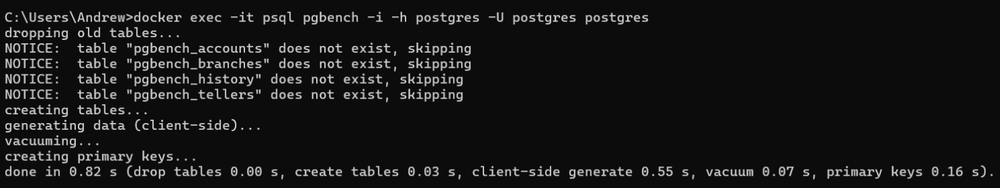
Прогон нагрузки
```sql
docker exec -it psql pgbench -c 8 -P 6 -T 60 -h postgres -U postgres postgres
```
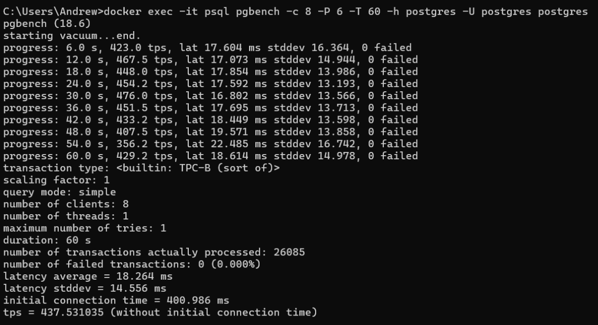

###### 3
n_dead_tup, last_autovacuum и last_vacuum для таблиц pgbench
```sql
SELECT relname, n_dead_tup, last_autovacuum, last_vacuum
FROM pg_stat_user_tables
ORDER BY relname;
```
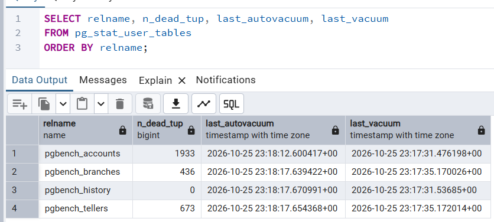

###### 4
Создание тестовой таблицы
```sql
CREATE TABLE test_table (  
    test_field TEXT NOT NULL
);
```
Заполнение тестовой таблицы
```sql
INSERT INTO test_table (test_field)
SELECT md5(random()::text)
FROM generate_series (1, 1000000);
```

###### 5
Размер тестовой таблицы
```sql
SELECT pg_total_relation_size('test_table');
```
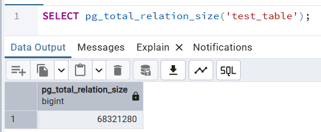

n_dead_tup тестовой таблицы
```sql
SELECT n_dead_tup
FROM pg_stat_user_tables
WHERE relname = 'test_table';
```
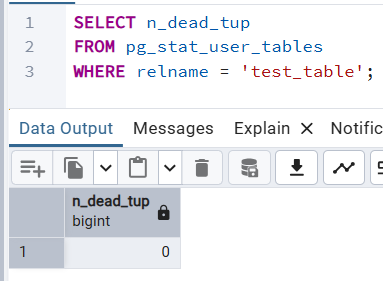

###### 6
5 обновлений всех строк таблицы test_table в анонимном блоке с выводом номера итерации
```sql
DO $$
BEGIN
    FOR i IN 1..5 LOOP
        UPDATE test_table
        SET test_field = test_field || '-' || i;

        RAISE NOTICE 'Итерация #%', i;
    END LOOP;
END$$;
```
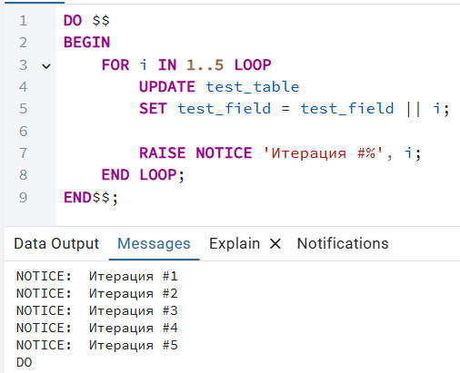

n_dead_tup и last_autovacuum тестовой таблицы
```sql
SELECT n_dead_tup, last_autovacuum
FROM pg_stat_user_tables
WHERE relname = 'test_table';
```
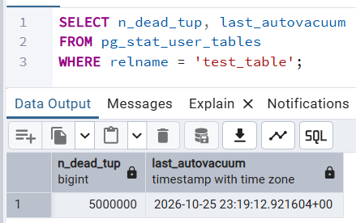

Размер тестовой таблицы
```sql
SELECT pg_total_relation_size('test_table');
```
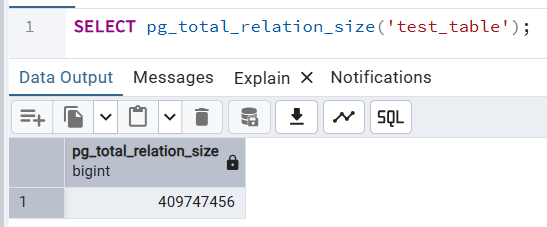

###### 7
Спустя некоторое время n_dead_tup стало 0, а last_autovacuum обновилось, значит сработал autovacuum.

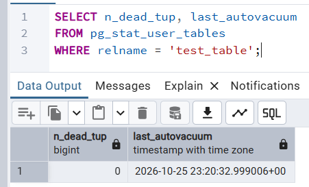

Размер таблицы не изменился.

###### 8
Отключаем autovacuum для таблицы test_table
```sql
ALTER TABLE test_table
    SET (autovacuum_enabled = false);
```
Выполняем 10 обновлений всех строк таблицы test_table в анонимном блоке с выводом номера итерации
```sql
DO $$
BEGIN
    FOR i IN 1..10 LOOP
        UPDATE test_table
        SET test_field = test_field || '-' || i;

        RAISE NOTICE 'Итерация #%', i;
    END LOOP;
END$$;
```
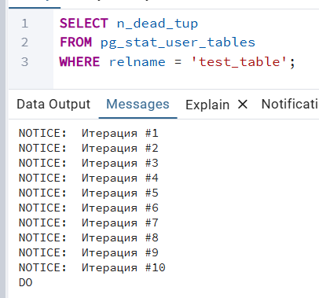

n_dead_tup тестовой таблицы
```sql
SELECT n_dead_tup
FROM pg_stat_user_tables
WHERE relname = 'test_table';
```
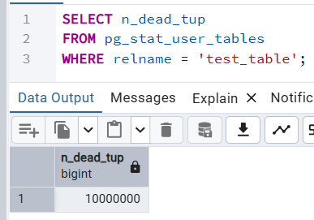

Размер тестовой таблицы
```sql
SELECT pg_total_relation_size('test_table');
```
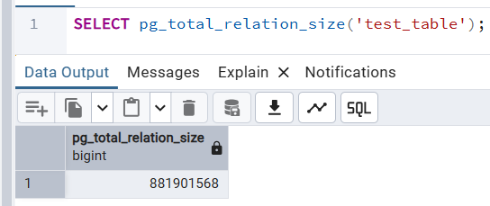

###### 9
После отключения autovacuum размер таблицы test_table и количество мёртвых строк сильно выросли.\
Ранее их чистил процесс autovacuum, а теперь их количество не уменьшается.

###### 10
Включаем autovacuum для таблицы test_table
```sql
ALTER TABLE test_table
    SET (autovacuum_enabled = true);
```
Спустя некоторое время n_dead_tup стало 0, а last_autovacuum обновилось, значит снова сработал autovacuum.

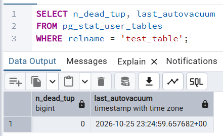
