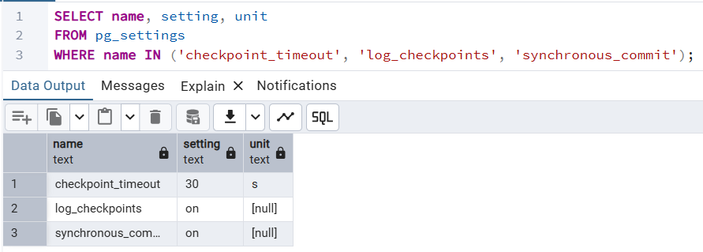
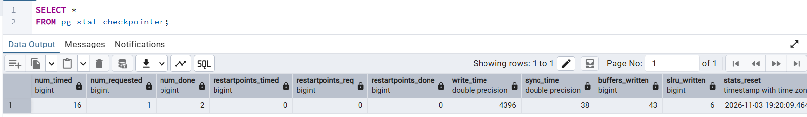
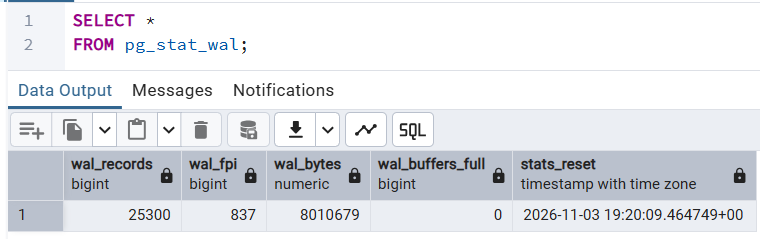
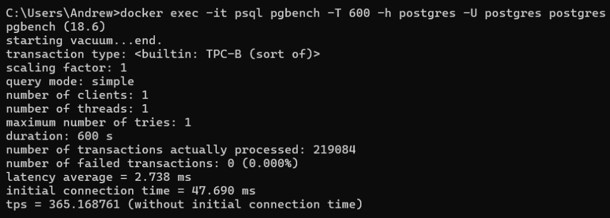
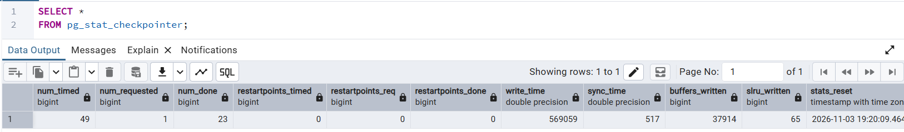
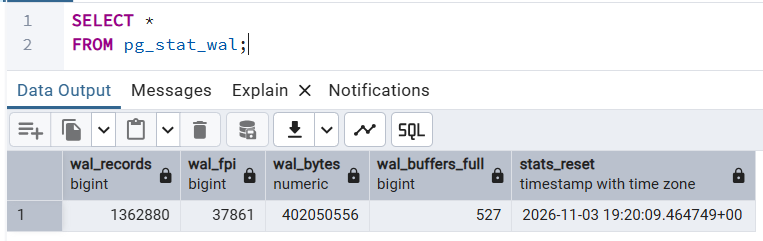
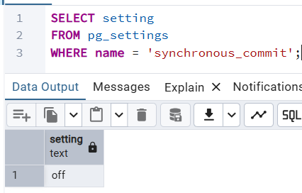
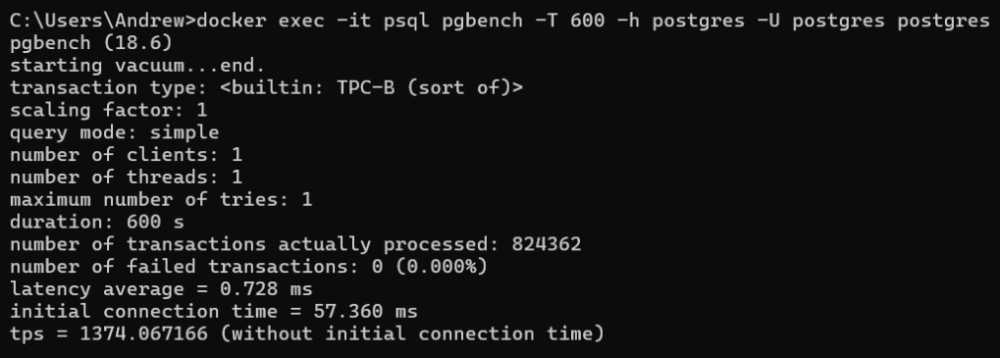

###### 1
Подготовка pgbench
```sh
docker exec -it psql pgbench -i -h postgres -U postgres postgres  
```

###### 2
Выставляем выполнение контрольной точки раз в 30 секунд (checkpoint_timeout).\
Логирование контрольных точек и synchronous_commit уже включены по умолчанию.
```sql
ALTER SYSTEM SET checkpoint_timeout = '30s';

SELECT pg_reload_conf();

SELECT name, setting, unit
FROM pg_settings
WHERE name IN ('checkpoint_timeout', 'log_checkpoints', 'synchronous_commit');
```


###### 3
Начальные значения статистики контрольных точек (num_done = 2)
```sql
SELECT *
FROM pg_stat_checkpointer;
```

Начальные значения статистики WAL
```sql
SELECT *
FROM pg_stat_wal;
```


###### 4
Запускаем pgbench на 10 минут с параметрами по умолчанию
```sh
docker exec -it psql pgbench -T 600 -h postgres -U postgres postgres  
```
tps = 365.168761\


###### 5
Конечные значения статистики контрольных точек (num_done = 23)\

Конечные значения статистики WAL\


###### 6
До прогона pgbench wal_bytes = 8010679.\
После прогона wal_bytes = 402050556.\
402050556 - 8010679 = 394039877 Б = ~376 МБ.

Судя по pg_stat_checkpointer.num_done, была 21 контрольная точка.\
В среднем 17.9 МБ (376 / 21) на одну контрольную точку.

###### 7
По [фрагменту](checkpoint.log) логов сервера, контрольные точки выполнялись почти по расписанию.\
Сообщения "checkpoint starting" появлялись раз в 30 секунд с погрешностью 100-200 мс.\
Скорее всего, pgbench не генерировал много нагрузки, не было контрольной точки по объёму данных (max_wal_size = 1 ГБ).\

###### 8
Выключаем подтверждение записи WAL
```sql
ALTER SYSTEM SET synchronous_commit = 'off';

SELECT pg_reload_conf();

SELECT setting
FROM pg_settings
WHERE name = 'synchronous_commit';
```


Снова запускаем pgbench на 10 минут, tps = 1374.067166\


При synchronous_commit = off сервер не ждёт записи на диск, поэтому TPS сильно больше.\
В таком режиме можно потерять результаты последних транзакций при сбоях питания или ОС.
