###### 1
Настраиваем запись ожидания блокировок дольше 200 мс в журнал сообщений.
```sql
ALTER SYSTEM SET deadlock_timeout = '200ms';  

ALTER SYSTEM SET log_lock_waits = 'on';  
  
SELECT pg_reload_conf();  
  
SELECT name, setting, unit  
FROM pg_settings  
WHERE name IN ('deadlock_timeout', 'log_lock_waits');
```
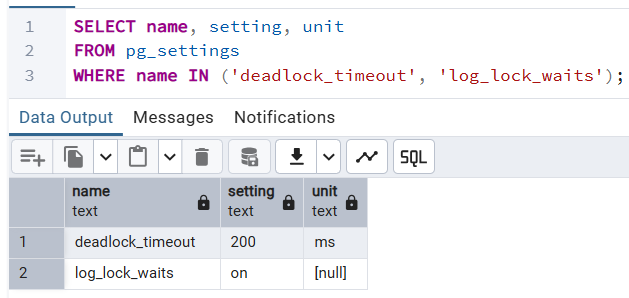

###### 2
Для воспроизведения блокировки создадим и заполним тестовую таблицу.
```sql
CREATE TABLE test (
    id    INT  PRIMARY KEY,     
    value TEXT NULL  
);

INSERT INTO test (id, value)
VALUES (1, 'test');
```
```sh
docker exec -it psql psql -h postgres -U postgres
```
Транзакция 1
```sql
BEGIN;

SELECT txid_current();

UPDATE test
SET value = value || '-1'
WHERE id = 1;
```
Транзакция 2
```sql
BEGIN;

SELECT txid_current();

UPDATE test
SET value = value || '-2'
WHERE id = 1;
```
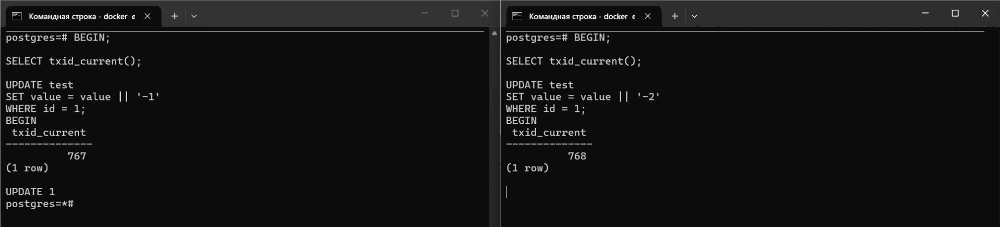
[Лог](logs/2.log)

###### 3-5
Используем таблицу test из п.2.

Транзакция 1
```sql
BEGIN;

SELECT txid_current();

UPDATE test
SET value = value || '-1'
WHERE id = 1;
```
Транзакция 2
```sql
BEGIN;

SELECT txid_current();

UPDATE test
SET value = value || '-2'
WHERE id = 1;
```
Транзакция 3
```sql
BEGIN;

SELECT txid_current();

UPDATE test
SET value = value || '-3'
WHERE id = 1;
```
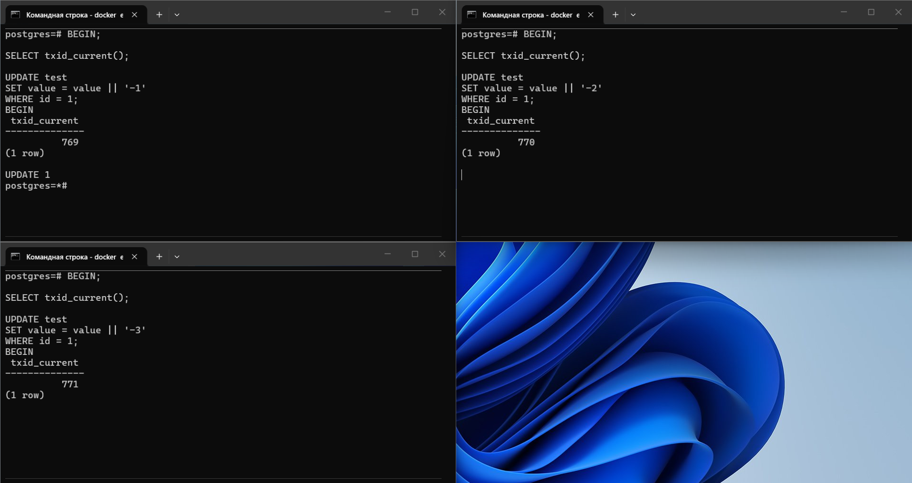
[Лог](logs/5.log)

###### 6-7
```sql
SELECT *
FROM pg_locks
ORDER BY relation, pid;
```

Узнаём oid таблицы test.
```sql
SELECT 'test'::regclass::oid;
```
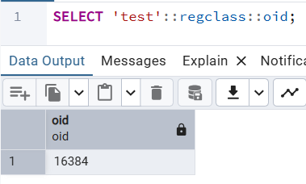

Узнаём, что oid 16390 имеет test_pkey.
```sql
SELECT relname
FROM pg_class
WHERE oid = 16390;
```
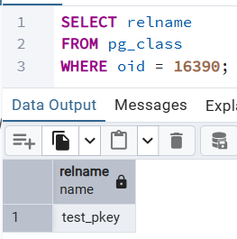

Первая транзакция имеет номер 769 и pid 4721, вторая - номер 770 и pid 4738, третья - номер 771 и pid 4747.\
В pg_locks в первую очередь нас интересуют записи с relation 16384 (таблица test) и 16390 (PK таблицы тест).\
locktype relation - блокировки уровня таблицы, tuple - блокирока конкретной строки.\
mode RowExclusiveLock вызван командой UPDATE, ExclusiveLock - более строгая, разрешающая только параллельное чтение.\
granted true - блокировка удерживается, false - ожидается.

До первой транзакции
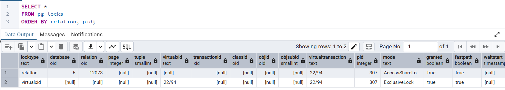

В первой транзакции добавились

| locktype | relation | mode             | granted |
| -------- | -------- | ---------------- | ------- |
| relation | 16384    | RowExclusiveLock | true    |
| relation | 16390    | RowExclusiveLock | true    |

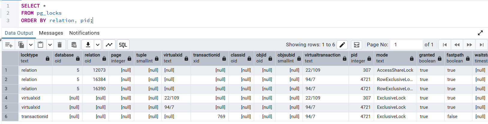

Во второй транзакции добавились

| locktype | relation | mode             | granted |
| -------- | -------- | ---------------- | ------- |
| relation | 16384    | RowExclusiveLock | true    |
| tuple    | 16384    | ExclusiveLock    | false   |
| relation | 16390    | RowExclusiveLock | true    |

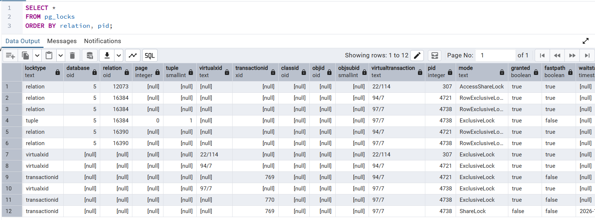

В третьей транзакции добавились

| locktype | relation | mode             | granted |
| -------- | -------- | ---------------- | ------- |
| relation | 16384    | RowExclusiveLock | true    |
| tuple    | 16384    | ExclusiveLock    | false   |
| relation | 16390    | RowExclusiveLock | true    |

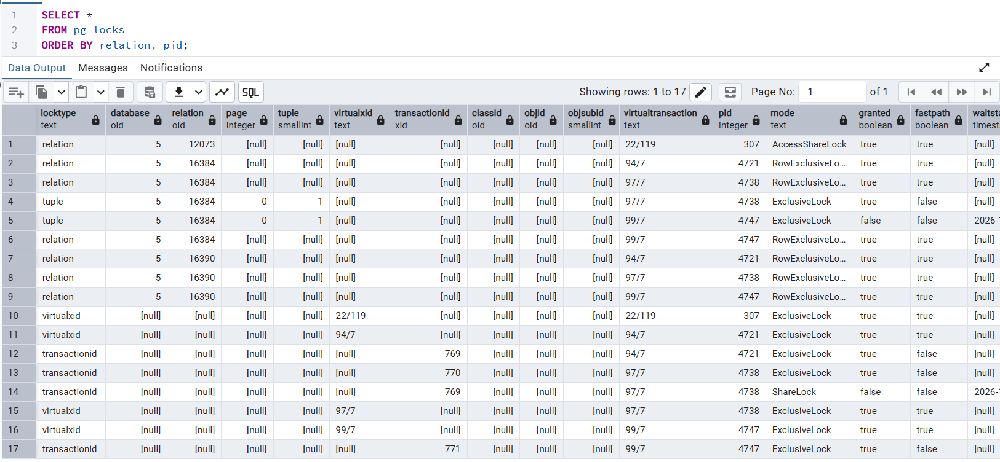

Первая транзакция блокирует строку.\
Затем вторая пытается обновить эту же строку, но не может из-за первой.\
Далее третья пытается обновить ту же строку, но не может из-за первой и второй.

COMMIT первой транзакции, теперь вторая транзакция блокирует строку.
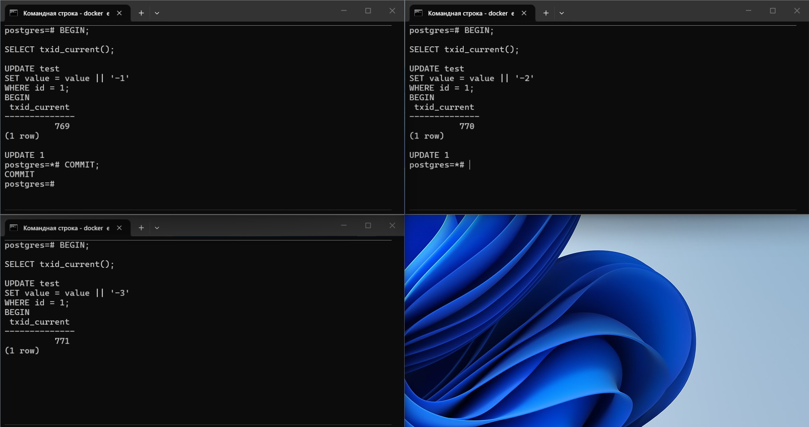
[Лог](logs/6-7/1-commit.log)

ROLLBACK второй транзакции, теперь третья транзакция блокирует строку.
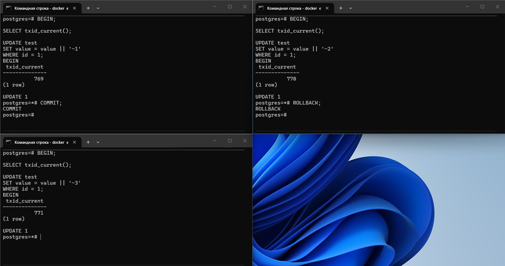
[Лог](logs/6-7/2-rollback.log)

COMMIT третьей транзакции, все транзакции завершены, таблица test не блокируется.


###### 8
```sql
UPDATE test
SET value = 'test'
WHERE id = 1;

INSERT INTO test (id, value)
VALUES (2, 'test'),
       (3, 'test')
```
Первая транзакция (786) блокирует строку с id = 1.
```sql
BEGIN;

SELECT txid_current();

SELECT *
FROM test
WHERE id = 1
FOR UPDATE;
```
Вторая транзакция (787) блокирует строку с id = 2.
```sql
BEGIN;

SELECT txid_current();

SELECT *
FROM test
WHERE id = 2
FOR UPDATE;
```
Третья транзакция (788) блокирует строку с id = 3.
```sql
BEGIN;

SELECT txid_current();

SELECT *
FROM test
WHERE id = 3
FOR UPDATE;
```
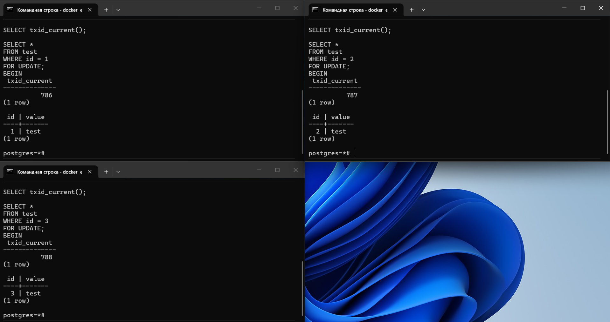

Первая транзакция (786) пытается обновить строку с id = 2, но не может из-за второй.
```sql
UPDATE test
SET value = 'test-2'
WHERE id = 2;
```
Вторая транзакция (787) пытается обновить строку с id = 3, но не может из-за третьей
```sql
UPDATE test
SET value = 'test-3'
WHERE id = 3;
```
Третья транзакция (788) пытается обновить строку с id = 1, но не может из-за первой и падает с "deadlock detected".
```sql
UPDATE test
SET value = 'test-1'
WHERE id = 1;
```
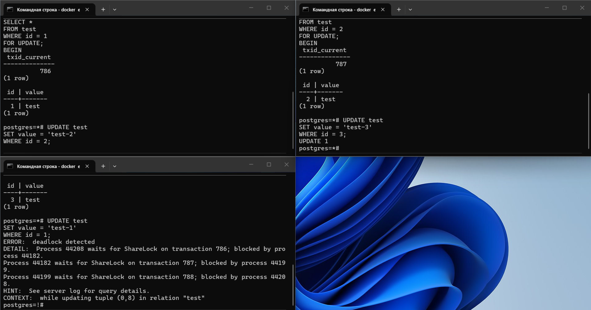

Я думаю, по [журналу сообщений](logs/8.log) можно будет разобраться в ситуации.\
Здесь видно, кто кого блокирует и каким запросом.

###### 9
Выполним запрос в двух транзакциях
```sql
BEGIN;

SELECT txid_current();

UPDATE test
SET value = 'test-1';
```

Первая транзакция блокирует все строки, вторая ожидает.
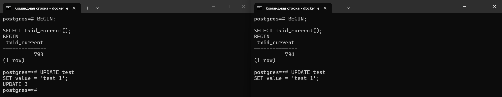

ROLLBACK первой транзакции, теперь вторая транзакция блокирует все строки.
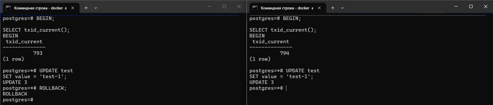

В [логе](logs/9/log.log) видна блокировка, но это не deadlock.

Для воспроизведения deadlock советуют иметь много записей в таблице и не иметь индексы, чтобы всегда было последовательное сканирование.\
И включить параметр synchronize_seqscans (уже по умолчанию).
```sql
TRUNCATE TABLE test;

INSERT INTO test (id, value)
SELECT i, 'test'
FROM generate_series (1, 1000000) i;
```
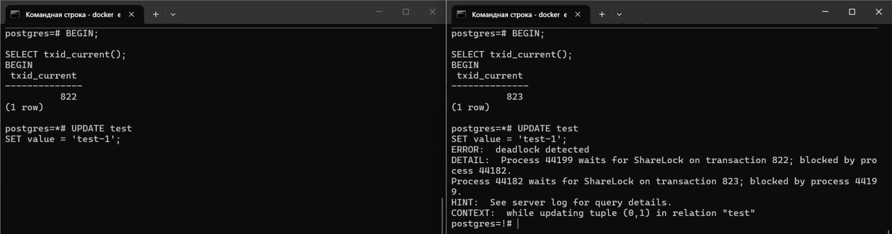
В [логе](logs/9/deadlock.log) виден deadlock.
