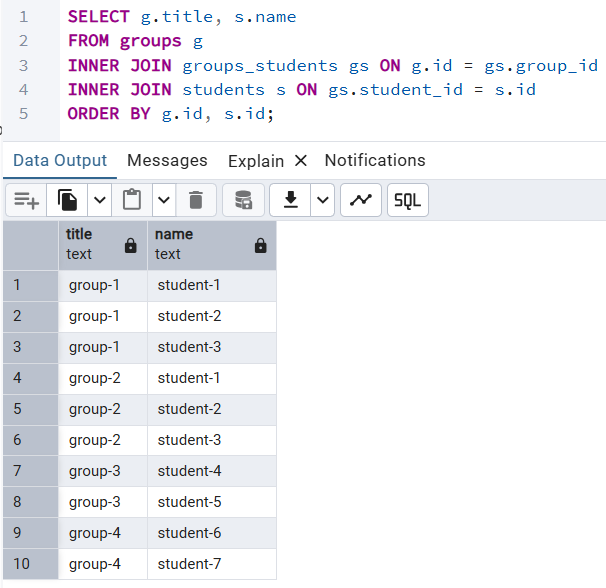
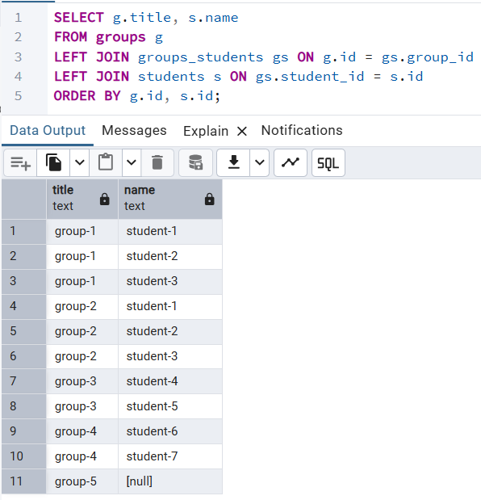
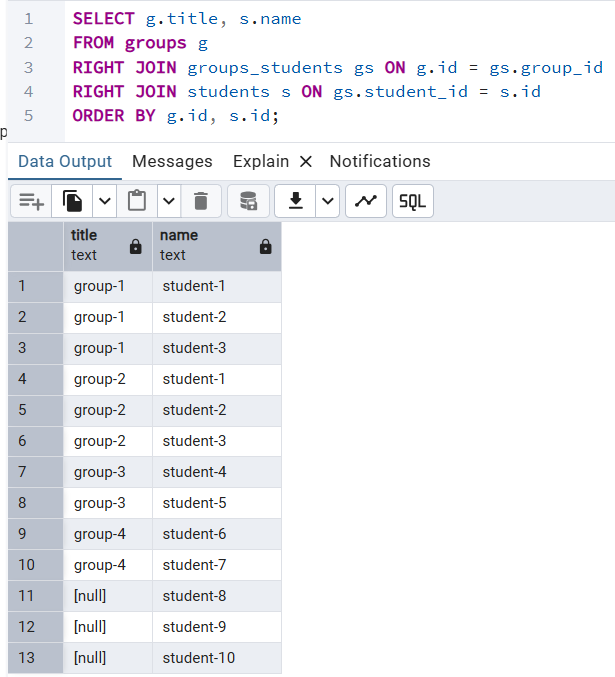
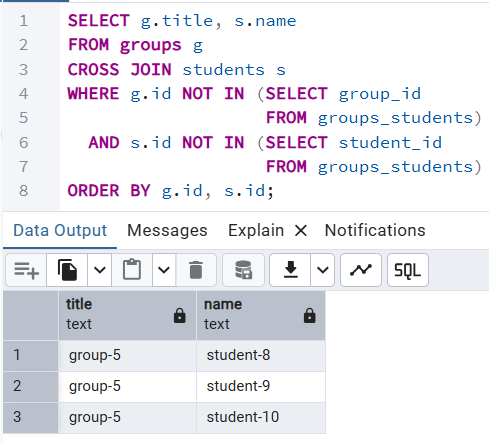
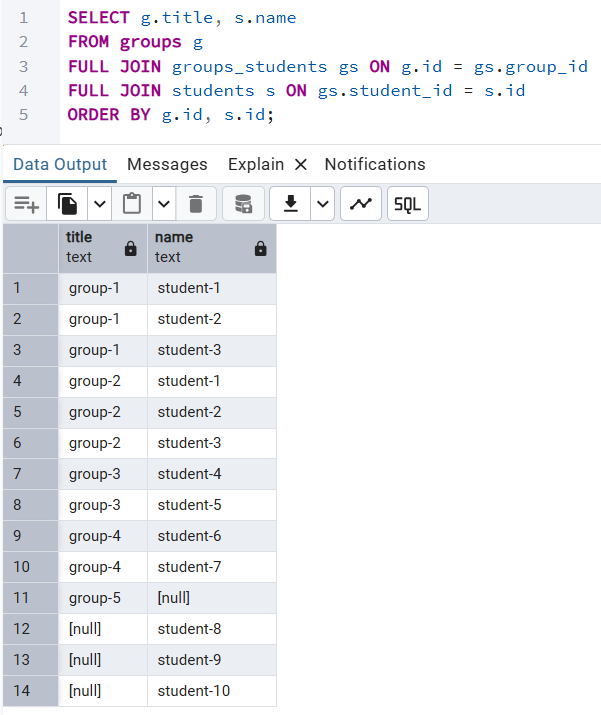
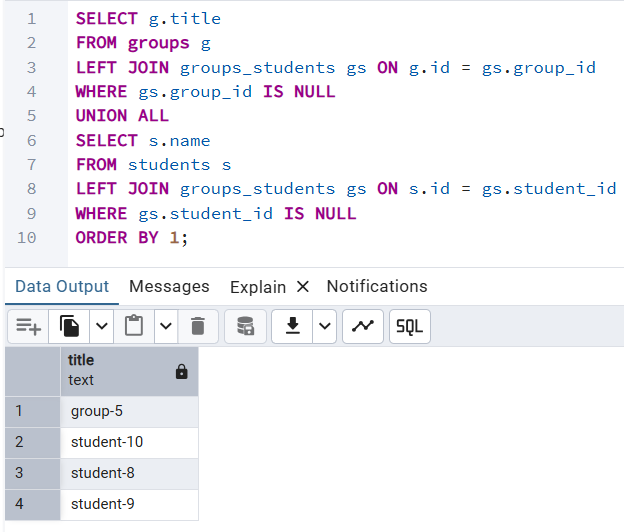

###### 1
Вывод названий групп и имён студентов в группе
```sql
SELECT g.title, s.name
FROM groups g
INNER JOIN groups_students gs ON g.id = gs.group_id
INNER JOIN students s ON gs.student_id = s.id
ORDER BY g.id, s.id;
```


###### 2
Вывод названий групп и имён студентов в группе, включая группы без студентов
```sql
SELECT g.title, s.name
FROM groups g
LEFT JOIN groups_students gs ON g.id = gs.group_id
LEFT JOIN students s ON gs.student_id = s.id
ORDER BY g.id, s.id;
```


Вывод названий групп и имён студентов в группе, включая студентов без группы
```sql
SELECT g.title, s.name
FROM groups g
RIGHT JOIN groups_students gs ON g.id = gs.group_id
RIGHT JOIN students s ON gs.student_id = s.id
ORDER BY g.id, s.id;
```


###### 3
Вывод групп без студентов CROSS JOIN студенты без группы
```sql
SELECT g.title, s.name
FROM groups g
CROSS JOIN students s
WHERE g.id NOT IN (SELECT group_id
                   FROM groups_students)
  AND s.id NOT IN (SELECT student_id
                   FROM groups_students)
ORDER BY g.id, s.id;
```


###### 4
Вывод названий групп и имён студентов в группе, включая группы без студентов и студентов без группы
```sql
SELECT g.title, s.name
FROM groups g
FULL JOIN groups_students gs ON g.id = gs.group_id
FULL JOIN students s ON gs.student_id = s.id
ORDER BY g.id, s.id;
```


###### 5
Вывод названий групп без студентов и имён студентов без групп
```sql
SELECT g.title
FROM groups g
LEFT JOIN groups_students gs ON g.id = gs.group_id
WHERE gs.group_id IS NULL
UNION ALL
SELECT s.name
FROM students s
LEFT JOIN groups_students gs ON s.id = gs.student_id
WHERE gs.student_id IS NULL
ORDER BY 1;
```


###### 6
Комментарии указаны в п.1-5.

###### 7
Для примера создадим таблицы группы, студенты и связь между ними (многие-ко-многим).\
```sql
CREATE TABLE groups (
    id    INT  PRIMARY KEY,
    title TEXT NOT NULL
);

CREATE TABLE students (
    id   INT  PRIMARY KEY,
    name TEXT NOT NULL
);

CREATE TABLE groups_students (
    group_id   INT NOT NULL REFERENCES groups (id),
    student_id INT NOT NULL REFERENCES students (id),
    PRIMARY KEY (group_id, student_id)
);
```
Пусть группа "group-5" будет без студентов, а студенты "student-8", "student-9" и "student-10" без группы.
```sql
INSERT INTO groups (id, title)
SELECT i, 'group-' || i
FROM generate_series (1, 5) i;

INSERT INTO students (id, name)
SELECT i, 'student-' || i
FROM generate_series (1, 10) i;

INSERT INTO groups_students (group_id, student_id)
VALUES (1, 1), (1, 2), (1, 3), -- в "group-1" студенты "student-1", "student-2" и "student-3"
       (2, 1), (2, 2), (2, 3), -- в "group-2" студенты "student-1", "student-2" и "student-3"
       (3, 4), (3, 5),         -- в "group-3" студенты "student-4" и "student-5"
       (4, 6), (4, 7);         -- в "group-4" студенты "student-6" и "student-7"
```
