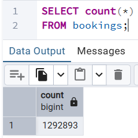
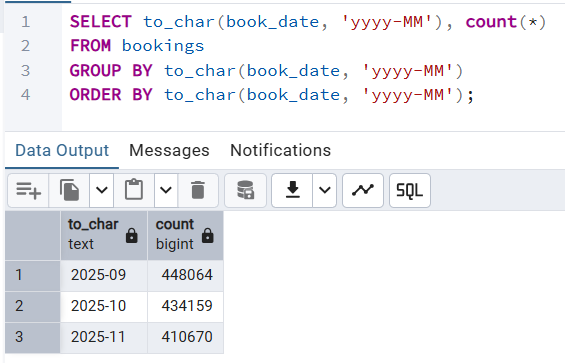
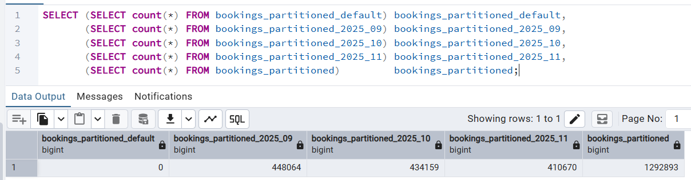
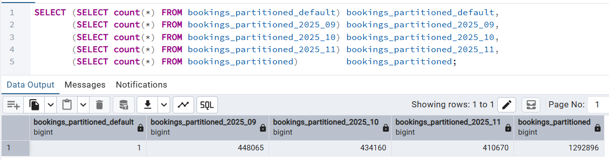
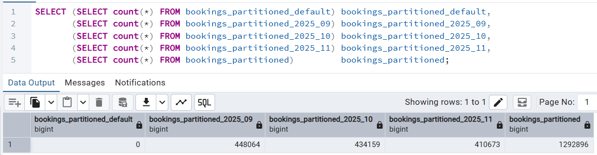
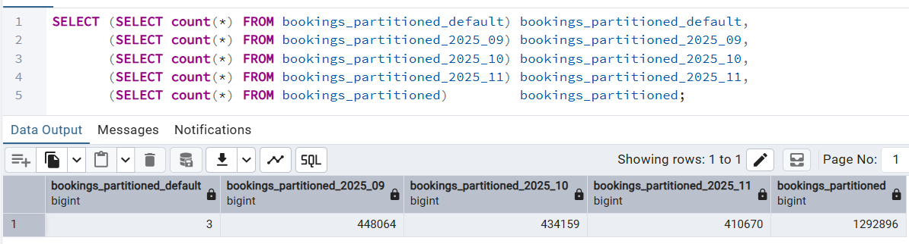
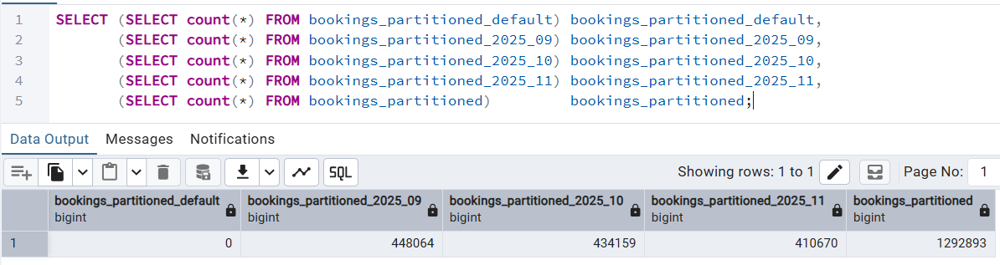
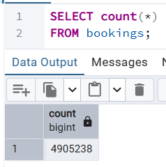
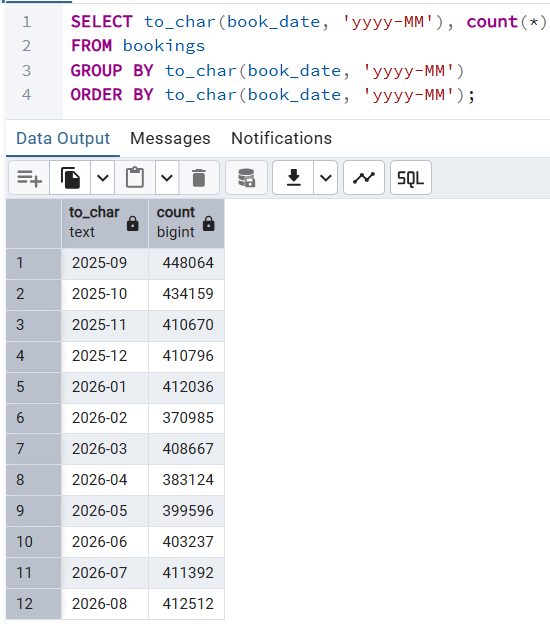

###### "Анализ структуры данных", "Выбор таблицы для секционирования" и "Определение типа секционирования"
Для примера сделаем секционирование по диапазону поля book_date таблицы bookings БД demo-20250901-3m.\
В этой таблице 1292893 записей.
```sql
SELECT count(*)
FROM bookings;
```


Данные за сентябрь-ноябрь 2025.
```sql
SELECT to_char(book_date, 'yyyy-MM'), count(*)
FROM bookings 
GROUP BY to_char(book_date, 'yyyy-MM')
ORDER BY to_char(book_date, 'yyyy-MM');
```


###### "Создание секционированной таблицы" и "Миграция данных"
Создадим таблицу bookings_partitioned, структура которой идентична структуре таблицы bookings.
```sql
CREATE TABLE bookings_partitioned (
    book_ref  CHARACTER(6)     NOT NULL,
    book_date TIMESTAMPTZ      NOT NULL,
    total_amount NUMERIC(10,2) NOT NULL,
    PRIMARY KEY (book_ref, book_date)
) PARTITION BY RANGE (book_date);
```
Создадим 4 секции для таблицы bookings_partitioned: секция DEFAULT и 3 секции для каждого месяца. 
```sql
CREATE TABLE bookings_partitioned_default PARTITION OF bookings_partitioned DEFAULT;
CREATE TABLE bookings_partitioned_2025_09 PARTITION OF bookings_partitioned FOR VALUES FROM ('2025-09-01') TO ('2025-10-01');
CREATE TABLE bookings_partitioned_2025_10 PARTITION OF bookings_partitioned FOR VALUES FROM ('2025-10-01') TO ('2025-11-01');
CREATE TABLE bookings_partitioned_2025_11 PARTITION OF bookings_partitioned FOR VALUES FROM ('2025-11-01') TO ('2025-12-01');
```
Скопируем данные из таблицы bookings в таблицу bookings_partitioned.
```sql
INSERT INTO bookings_partitioned
OVERRIDING SYSTEM VALUE
SELECT *
FROM bookings;
```

###### Оптимизация запросов
Используем такие запросы для тестов.
```sql
EXPLAIN ANALYZE
SELECT count(*)
FROM bookings
WHERE book_date BETWEEN '2025-10-14' AND '2025-10-15';

EXPLAIN ANALYZE
SELECT count(*)
FROM bookings_partitioned
WHERE book_date BETWEEN '2025-10-14' AND '2025-10-15';
```
План запроса в таблицу bookings.
```
Finalize Aggregate  (cost=17331.79..17331.80 rows=1 width=8) (actual time=192.290..196.913 rows=1.00 loops=1)
  Buffers: shared hit=2161 read=6074
  ->  Gather  (cost=17331.58..17331.79 rows=2 width=8) (actual time=192.201..196.906 rows=3.00 loops=1)
        Workers Planned: 2
        Workers Launched: 2
        Buffers: shared hit=2161 read=6074
        ->  Partial Aggregate  (cost=16331.58..16331.59 rows=1 width=8) (actual time=66.953..66.955 rows=1.00 loops=3)
              Buffers: shared hit=2161 read=6074
              ->  Parallel Seq Scan on bookings  (cost=0.00..16315.58 rows=6399 width=0) (actual time=41.955..66.724 rows=4769.00 loops=3)
                    Filter: ((book_date >= '2025-10-14 00:00:00+00'::timestamp with time zone) AND (book_date <= '2025-10-15 00:00:00+00'::timestamp with time zone))
                    Rows Removed by Filter: 426195
                    Buffers: shared hit=2161 read=6074
Planning Time: 0.068 ms
Execution Time: 196.944 ms
```
План запроса в таблицу bookings_partitioned.
```
Finalize Aggregate  (cost=7618.39..7618.40 rows=1 width=8) (actual time=79.130..82.048 rows=1.00 loops=1)
  Buffers: shared hit=2766
  ->  Gather  (cost=7618.18..7618.39 rows=2 width=8) (actual time=32.344..82.039 rows=2.00 loops=1)
        Workers Planned: 1
        Workers Launched: 1
        Buffers: shared hit=2766
        ->  Partial Aggregate  (cost=6618.18..6618.19 rows=1 width=8) (actual time=16.089..16.089 rows=1.00 loops=2)
              Buffers: shared hit=2766
              ->  Parallel Seq Scan on bookings_partitioned_2025_10 bookings_partitioned  (cost=0.00..6596.81 rows=8545 width=0) (actual time=7.190..15.646 rows=7153.50 loops=2)
                    Filter: ((book_date >= '2025-10-14 00:00:00+00'::timestamp with time zone) AND (book_date <= '2025-10-15 00:00:00+00'::timestamp with time zone))
                    Rows Removed by Filter: 209926
                    Buffers: shared hit=2766
Planning Time: 0.117 ms
Execution Time: 82.074 ms
```
Как видно в планах, запрос в bookings делает Seq Scan всей таблицы.\
Запрос в bookings_partitioned тоже делает Seq Scan, но не всей таблицы, а только одной секции bookings_partitioned_2025_10.

Добавим индекс по book_date в таблицы bookings и bookings_partitioned и заново выполним запросы к ним.
```sql
CREATE INDEX ON bookings (book_date);
CREATE INDEX ON bookings_partitioned (book_date);
```
План запроса в таблицу bookings.
```
Aggregate  (cost=470.39..470.40 rows=1 width=8) (actual time=2.787..2.788 rows=1.00 loops=1)
  Buffers: shared hit=43
  ->  Index Only Scan using bookings_book_date_idx on bookings  (cost=0.43..435.51 rows=13954 width=0) (actual time=0.041..1.882 rows=14307.00 loops=1)
        Index Cond: ((book_date >= '2025-10-14 00:00:00+00'::timestamp with time zone) AND (book_date <= '2025-10-15 00:00:00+00'::timestamp with time zone))
        Heap Fetches: 0
        Index Searches: 1
        Buffers: shared hit=43
Planning Time: 0.137 ms
Execution Time: 2.822 ms
```
План запроса в таблицу bookings_partitioned.
```
Aggregate  (cost=484.92..484.93 rows=1 width=8) (actual time=1.875..1.875 rows=1.00 loops=1)
  Buffers: shared hit=43
  ->  Index Only Scan using bookings_partitioned_2025_10_book_date_idx on bookings_partitioned_2025_10 bookings_partitioned  (cost=0.42..448.86 rows=14422 width=0) (actual time=0.037..1.248 rows=14307.00 loops=1)
        Index Cond: ((book_date >= '2025-10-14 00:00:00+00'::timestamp with time zone) AND (book_date <= '2025-10-15 00:00:00+00'::timestamp with time zone))
        Heap Fetches: 0
        Index Searches: 1
        Buffers: shared hit=43
Planning Time: 0.143 ms
Execution Time: 1.898 ms
```
Теперь оба запроса делают Index Only Scan и работают примерно одинаковое время.\
На таких небольших данных изменения почти незаметны.

###### Тестирование решения
Проверим количество записей в каждой секции.
```sql
SELECT (SELECT count(*) FROM bookings_partitioned_default) bookings_partitioned_default,
       (SELECT count(*) FROM bookings_partitioned_2025_09) bookings_partitioned_2025_09,
       (SELECT count(*) FROM bookings_partitioned_2025_10) bookings_partitioned_2025_10,
       (SELECT count(*) FROM bookings_partitioned_2025_11) bookings_partitioned_2025_11,
       (SELECT count(*) FROM bookings_partitioned)         bookings_partitioned;
```

Вставим 3 записи, которые должны попасть в разные секции
```sql
INSERT INTO bookings_partitioned (book_ref, book_date, total_amount)
VALUES ('AAAAAA', '2025-08-31 00:00:00', 1),
       ('BBBBBB', '2025-09-30 00:00:00', 1),
       ('CCCCCC', '2025-10-31 00:00:00', 1);
```

Обновим этим записям book_date, чтобы они переместились в новую секцию
```sql
UPDATE bookings_partitioned
SET book_date = '2025-11-30 00:00:00'
WHERE book_ref IN ('AAAAAA', 'BBBBBB', 'CCCCCC');
```

Обновим этим записям book_date, чтобы они переместились в секцию DEFAULT
```sql
UPDATE bookings_partitioned
SET book_date = '2025-08-31 00:00:00'
WHERE book_ref IN ('AAAAAA', 'BBBBBB', 'CCCCCC');
```

Удалим записи
```sql
DELETE
FROM bookings_partitioned
WHERE book_ref IN ('AAAAAA', 'BBBBBB', 'CCCCCC');
```


###### demo-20250901-1y
Для наглядности повторим секционирование и те же запросы count(*) в БД demo-20250901-1y.

Теперь в этой таблице 4905238 записей.\


И данные за сентябрь 2025 - август 2026.\


Поэтому нужно создать больше секций.
```sql
CREATE TABLE bookings_partitioned_default PARTITION OF bookings_partitioned DEFAULT;
CREATE TABLE bookings_partitioned_2025_09 PARTITION OF bookings_partitioned FOR VALUES FROM ('2025-09-01') TO ('2025-10-01');
CREATE TABLE bookings_partitioned_2025_10 PARTITION OF bookings_partitioned FOR VALUES FROM ('2025-10-01') TO ('2025-11-01');
CREATE TABLE bookings_partitioned_2025_11 PARTITION OF bookings_partitioned FOR VALUES FROM ('2025-11-01') TO ('2025-12-01');
CREATE TABLE bookings_partitioned_2025_12 PARTITION OF bookings_partitioned FOR VALUES FROM ('2025-12-01') TO ('2026-01-01');
CREATE TABLE bookings_partitioned_2026_01 PARTITION OF bookings_partitioned FOR VALUES FROM ('2026-01-01') TO ('2026-02-01');
CREATE TABLE bookings_partitioned_2026_02 PARTITION OF bookings_partitioned FOR VALUES FROM ('2026-02-01') TO ('2026-03-01');
CREATE TABLE bookings_partitioned_2026_03 PARTITION OF bookings_partitioned FOR VALUES FROM ('2026-03-01') TO ('2026-04-01');
CREATE TABLE bookings_partitioned_2026_04 PARTITION OF bookings_partitioned FOR VALUES FROM ('2026-04-01') TO ('2026-05-01');
CREATE TABLE bookings_partitioned_2026_05 PARTITION OF bookings_partitioned FOR VALUES FROM ('2026-05-01') TO ('2026-06-01');
CREATE TABLE bookings_partitioned_2026_06 PARTITION OF bookings_partitioned FOR VALUES FROM ('2026-06-01') TO ('2026-07-01');
CREATE TABLE bookings_partitioned_2026_07 PARTITION OF bookings_partitioned FOR VALUES FROM ('2026-07-01') TO ('2026-08-01');
CREATE TABLE bookings_partitioned_2026_08 PARTITION OF bookings_partitioned FOR VALUES FROM ('2026-08-01') TO ('2026-09-01');
```
План запроса в таблицу bookings.
```
Finalize Aggregate  (cost=62917.01..62917.02 rows=1 width=8) (actual time=721.291..724.750 rows=1.00 loops=1)
  Buffers: shared hit=2350 read=28894
  ->  Gather  (cost=62916.80..62917.01 rows=2 width=8) (actual time=721.159..724.743 rows=3.00 loops=1)
        Workers Planned: 2
        Workers Launched: 2
        Buffers: shared hit=2350 read=28894
        ->  Partial Aggregate  (cost=61916.80..61916.81 rows=1 width=8) (actual time=593.487..593.488 rows=1.00 loops=3)
              Buffers: shared hit=2350 read=28894
              ->  Parallel Seq Scan on bookings  (cost=0.00..61901.72 rows=6031 width=0) (actual time=391.020..593.253 rows=4769.00 loops=3)
                    Filter: ((book_date >= '2025-10-14 00:00:00+00'::timestamp with time zone) AND (book_date <= '2025-10-15 00:00:00+00'::timestamp with time zone))
                    Rows Removed by Filter: 1630310
                    Buffers: shared hit=2350 read=28894
Planning Time: 0.050 ms
Execution Time: 724.773 ms
```
План запроса в таблицу bookings_partitioned.
```
Finalize Aggregate  (cost=7617.18..7617.19 rows=1 width=8) (actual time=81.527..85.108 rows=1.00 loops=1)
  Buffers: shared hit=2766
  ->  Gather  (cost=7616.97..7617.18 rows=2 width=8) (actual time=33.001..85.098 rows=2.00 loops=1)
        Workers Planned: 1
        Workers Launched: 1
        Buffers: shared hit=2766
        ->  Partial Aggregate  (cost=6616.97..6616.98 rows=1 width=8) (actual time=16.424..16.425 rows=1.00 loops=2)
              Buffers: shared hit=2766
              ->  Parallel Seq Scan on bookings_partitioned_2025_10 bookings_partitioned  (cost=0.00..6596.81 rows=8062 width=0) (actual time=6.705..15.971 rows=7153.50 loops=2)
                    Filter: ((book_date >= '2025-10-14 00:00:00+00'::timestamp with time zone) AND (book_date <= '2025-10-15 00:00:00+00'::timestamp with time zone))
                    Rows Removed by Filter: 209926
                    Buffers: shared hit=2766
Planning Time: 0.115 ms
Execution Time: 85.137 ms
```
Как опять видно в планах, запрос в bookings делает Seq Scan всей таблицы, а запрос в bookings_partitioned одной секции.\

Проверим с индексами по book_date.\
План запроса в таблицу bookings.
```
Aggregate  (cost=457.29..457.30 rows=1 width=8) (actual time=2.769..2.769 rows=1.00 loops=1)
  Buffers: shared hit=43
  ->  Index Only Scan using bookings_book_date_idx on bookings  (cost=0.43..423.41 rows=13549 width=0) (actual time=0.033..1.810 rows=14307.00 loops=1)
        Index Cond: ((book_date >= '2025-10-14 00:00:00+00'::timestamp with time zone) AND (book_date <= '2025-10-15 00:00:00+00'::timestamp with time zone))
        Heap Fetches: 0
        Index Searches: 1
        Buffers: shared hit=43
Planning Time: 0.081 ms
Execution Time: 2.798 ms
```
План запроса в таблицу bookings_partitioned.
```
Aggregate  (cost=484.04..484.05 rows=1 width=8) (actual time=1.817..1.818 rows=1.00 loops=1)
  Buffers: shared hit=43
  ->  Index Only Scan using bookings_partitioned_2025_10_book_date_idx on bookings_partitioned_2025_10 bookings_partitioned  (cost=0.42..448.08 rows=14383 width=0) (actual time=0.020..1.245 rows=14307.00 loops=1)
        Index Cond: ((book_date >= '2025-10-14 00:00:00+00'::timestamp with time zone) AND (book_date <= '2025-10-15 00:00:00+00'::timestamp with time zone))
        Heap Fetches: 0
        Index Searches: 1
        Buffers: shared hit=43
Planning Time: 0.101 ms
Execution Time: 1.831 ms
```
Оба запроса опять делают Index Only Scan и работают примерно одинаковое время.\
На моей машине особо нет разницы между demo-20250901-3m и demo-20250901-1y.

Я думаю, в реальных условиях секционирование будет полезно на большем количестве данных.\
Особенно, если архивные данные нужны редко или не нужны вообще.
